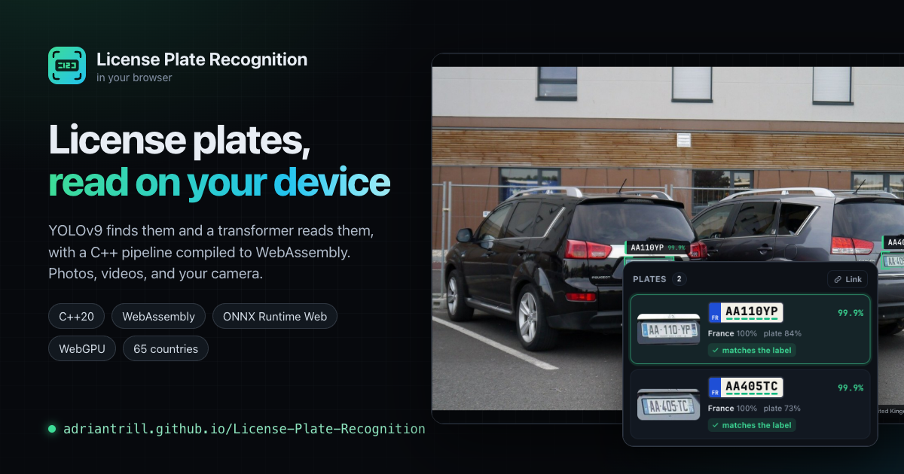
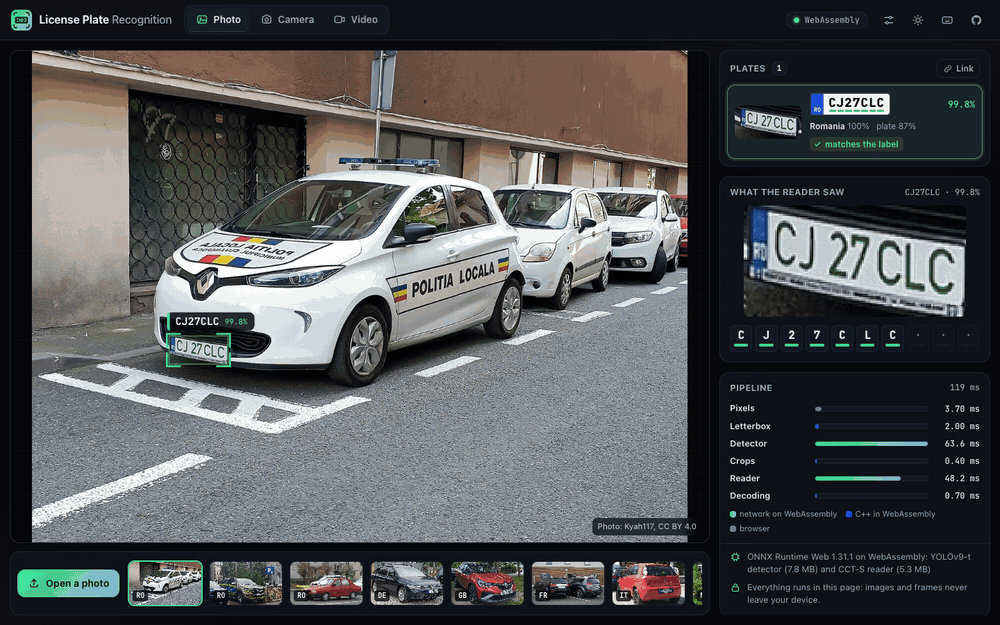
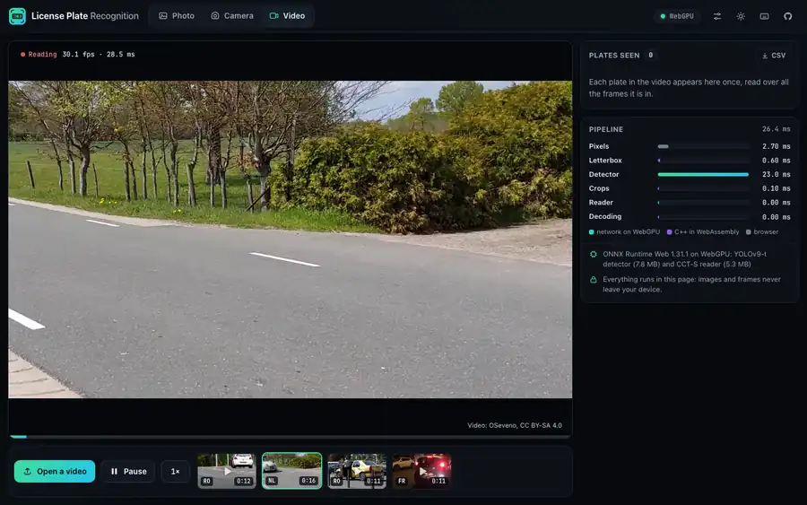
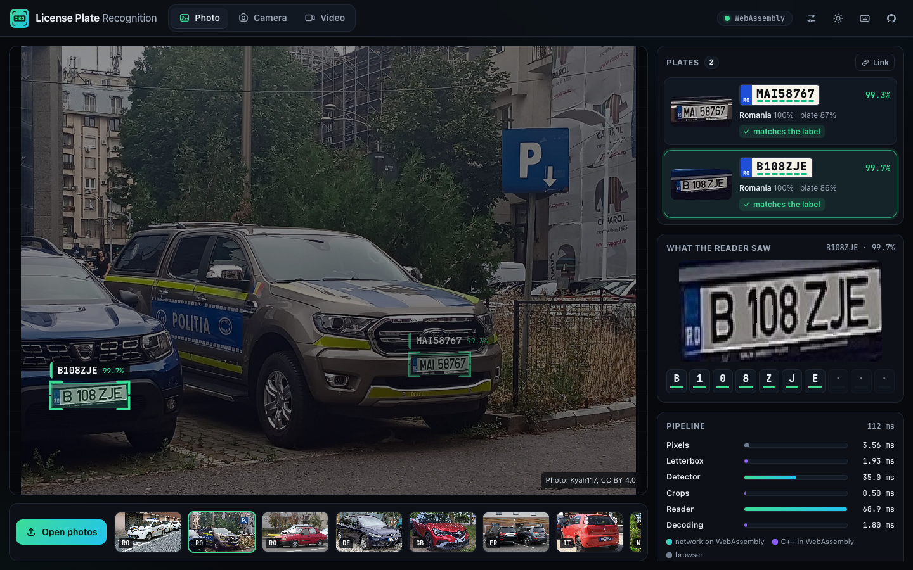
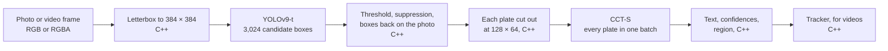
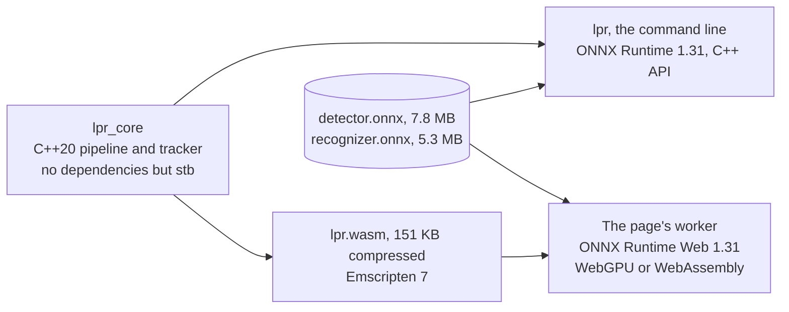
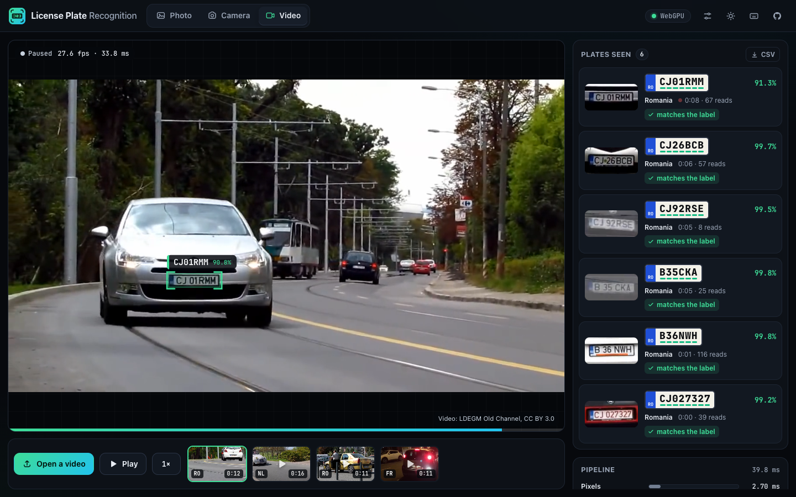

<p align="center">
  <a href="https://adriantrill.github.io/License-Plate-Recognition/"></a>
</p>

<p align="center">
  <a href="https://github.com/AdrianTrill/License-Plate-Recognition/actions/workflows/ci.yml"></a>
  <a href="https://adriantrill.github.io/License-Plate-Recognition/"></a>
  
  
  
  
  <a href="LICENSE"></a>
</p>

License Plate Recognition finds and reads license plates in photos, videos, and a live camera. A YOLOv9-t detector finds the plates, a Compact Convolutional Transformer reads each one, character by character, for 65 countries, and a C++20 pipeline does everything around the two networks: the letterbox, non-maximum suppression, the crops, the decoding, and the tracker that follows plates through a video. The same pipeline runs natively, on ONNX Runtime, behind a command line, and in the browser, compiled to WebAssembly beside ONNX Runtime Web, where it gives the networks the same inputs bit for bit. On the 444 photos of the OpenALPR benchmark it finds 443 plates and reads 411 of them exactly (92.6%).

<p align="center">
  <a href="https://adriantrill.github.io/License-Plate-Recognition/"></a>
</p>
<p align="center"><em>The <a href="https://adriantrill.github.io/License-Plate-Recognition/">live demo</a> on GitHub Pages: sample photos read in the page, and a plate inspected.</em></p>

<p align="center">
  <a href="https://adriantrill.github.io/License-Plate-Recognition/?video=nl-2cv-parade"></a>
</p>
<p align="center"><em>The video mode, on one of its sample videos: each plate outlined as its car passes, and logged once.</em></p>

## What's inside

| Part | What it does | How it is checked |
| --- | --- | --- |
| **[Live demo](#try-it)** | Photos, videos, and the camera, read in the page on WebGPU, or on WebAssembly on four threads, with twelve sample photos and four sample videos. The networks, 13 MB, download once, are checked against their SHA-256, and stay cached | Headless Chrome reads every sample photo, plays a sample video and checks its log, and runs the camera, on every push |
| **[One pipeline, two runtimes](#one-pipeline-two-runtimes)** | The C++20 pipeline natively with ONNX Runtime, and compiled to WebAssembly with ONNX Runtime Web | On all 444 benchmark photos, the networks' inputs are identical bit for bit and every reading is the same |
| **[Detection](#how-a-photo-is-read)** | YOLOv9-t at 384 pixels, with its non-maximum suppression moved out of the graph into C++, so its thresholds change as you drag them | The cut graph and the C++ suppression must find exactly the published graph's plates before the model is written |
| **[Reading](#how-a-photo-is-read)** | Ten character slots and 66 regions, and a confidence that is the network's probability for exactly the text it read | Unit tests, and twelve labeled photos from ten countries |
| **[Video](#following-plates-through-a-video)** | Plates followed from frame to frame, their reads fused, and each one logged once; a video plays at its own speed, shown a fraction of a second behind so that each outline fits its plate in every frame | Unit tests, the four sample videos read natively against their labels, and in the browser |
| **[Measured accuracy](#measured-accuracy)** | 443 of 444 plates found and 411 read exactly; 96.7% exact among the 90% of reads it is surest of | CI downloads the benchmark, runs it again, and requires the same numbers |
| **[Command line](#command-line)** | `lpr`: photos to a table, JSON, or annotated copies; videos from ffmpeg; the evaluation; timings | CTest, on Linux, macOS, and Windows, and under AddressSanitizer |

**Contents:** [Try it](#try-it) · [The demo](#the-demo) · [How a photo is read](#how-a-photo-is-read) · [Two runtimes](#one-pipeline-two-runtimes) · [Video](#following-plates-through-a-video) · [Accuracy](#measured-accuracy) · [Speed](#speed) · [Command line](#command-line) · [Build](#build) · [Layout](#repository-layout) · [Tests and CI](#tests-and-ci) · [Credits](#credits)

## Try it

**[Open the live demo](https://adriantrill.github.io/License-Plate-Recognition/).** It opens on a photo from Cluj-Napoca, already read. Pick another of the twelve sample photos, play one of the four sample videos, drop or paste a photo or open a video of your own, or start the camera; on a phone the camera opens on the back. The first visit downloads ONNX Runtime Web (7 MB compressed for WebGPU, 4 MB without) and the two networks (11 MB compressed), checks the networks against the SHA-256 hashes in their manifest, and keeps them for next time. Whatever you open stays in the page. Press <kbd>?</kbd> for the shortcuts.

Or read plates from a terminal:

```bash
pip install -r tools/requirements.txt && python tools/prepare_models.py
cmake -S . -B build -DCMAKE_BUILD_TYPE=Release && cmake --build build --parallel
./build/lpr samples/*.jpg
```

## The demo

<p align="center">
  
</p>

- **The viewer** outlines each plate with corner marks and labels it with its text and confidence. Hovering a plate, or its card, brings it forward; a click pins it.
- **The plates** show each reading on a plate of its own, with the region's code on a band, and each character underlined in green, amber, or red by how sure the reader is of it; hovering a character lists the symbols it nearly read instead. For the samples, each reading is checked against the photo's label.
- **What the reader saw** shows the 128×64 pixels the reader was given for the plate, and its confidence in each of its ten slots; the slots past the end of the plate hold padding.
- **The pipeline** shows where the time went, stage by stage, colored by where each stage runs: in a network, in the C++ compiled to WebAssembly, or in the browser.
- **Settings** (<kbd>S</kbd>) change the detector's threshold and the overlap limit of its suppression, and the photo is read again as you drag them; WebGPU can be switched off, and the labels hidden. The page comes in dark and light themes, works on phones, and gives each sample photo and video a link of its own.

## How a photo is read



- **The letterbox** scales the photo to fit 384×384 and pads it with YOLO's gray, rounding exactly as the detector's reference preprocessing does. The resampling is bilinear with OpenCV's pixel geometry, in 11-bit fixed point computed with integers only: a unit test holds it to within one level of OpenCV's `INTER_LINEAR`, and every platform, WebAssembly included, produces the same bytes. A smoothed, area-averaging resize was tried; it found 2 fewer plates on the benchmark and read 5 fewer, so the pipeline keeps the reference's.
- **The detector** is [open-image-models](https://github.com/ankandrew/open-image-models)' YOLOv9-t, trained on license plates. It is published "end to end", with ONNX's `NonMaxSuppression` inside the graph. [`tools/prepare_models.py`](tools/prepare_models.py) cuts the graph where the detection head ends, so its output is the raw `[1, 5, 3024]`: a center, a size, and a plate score for every anchor. [`src/detector.cpp`](src/detector.cpp) keeps the boxes at or above the threshold, suppresses those that overlap a better one by more than the limit, and maps the rest back onto the photo. With suppression in C++, its thresholds are settings rather than constants of the graph, and the whole network runs on WebGPU. The tool refuses to write the cut graph unless, followed by the C++ suppression, it finds exactly the published graph's plates on the sample photos.
- **The crops** are taken as the reference implementation, [fast-alpr](https://github.com/ankandrew/fast-alpr), takes them, and stretched to the reader's 128×64 RGB input.
- **The reader** is [fast-plate-ocr](https://github.com/ankandrew/fast-plate-ocr)'s `cct-s-v2-global-model`, which reads plates from 65 countries in ten slots of 37 symbols: digits, capital letters, and padding. The text is each slot's likeliest symbol, with the padding at its end removed. Its confidence is the product of those slots' probabilities, padding included: the network's probability for exactly that text. That ranks readings well enough to act on (see [accuracy](#measured-accuracy)). A second head names the plate's region, shown as the band's code.

## One pipeline, two runtimes



A browser runs the networks asynchronously, so the pipeline ([`include/lpr/pipeline.hpp`](include/lpr/pipeline.hpp)) is three calls: `prepare` returns the detector's input, `detected` takes its output and returns the plates' crops, and `read` takes the reader's output and returns the plates. In the page, a worker ([`web/js/worker.js`](web/js/worker.js)) makes those calls through [`web/lpr_wasm.cpp`](web/lpr_wasm.cpp) and runs ONNX Runtime Web between them; natively, `Pipeline::run` makes the same calls around [`OnnxEngine`](src/onnx_engine.cpp). Both print the same JSON.

Both builds compute the same bytes: the resampling uses integers, pixels become floats through one table, and fused multiply-adds are off (`-ffp-contract=off`), since they round differently from a multiply and an add. [`web/check.mjs`](web/check.mjs) holds them to it. It decodes each photo with the same stb_image in both builds, reads it in WebAssembly with ONNX Runtime Web in Node, and compares fingerprints of the networks' inputs and the plates with those of `lpr --json --trace`. On all 444 benchmark photos (479 plates) every input matched bit for bit and every text matched; boxes agreed to 0.1 pixel and confidences to 0.0001, as the two runtimes' kernels add in different orders. CI runs it on the samples on every push.

## Following plates through a video

<p align="center">
  
</p>

The video mode comes with four sample videos from Wikimedia Commons, each labeled with the plates it shows: traffic on a tram line in Cluj-Napoca, a Citroën 2CV parade in the Netherlands, a taxi in Sibiu, and parallel parking at night in Lyon. The first one plays as the mode opens, and the log checks each plate against the labels. In camera and video modes the page reads frames as fast as the networks allow, and [`PlateTracker`](include/lpr/tracker.hpp) follows the plates between them:

- **Matching.** Each plate continues the track whose predicted box it overlaps most; the prediction moves the last box at the track's velocity. A plate too fast to overlap is matched to the nearest track of about its size within a plate's width, and a track seen in the frame before reaches a width further for each 40 ms between the frames, up to four: at WebAssembly's 9 frames a second, a passing car's plate moves two or three widths between reads.
- **Fusion.** A track's reads are averaged slot by slot, each weighted by its confidence, so a blurred frame counts for little and a misread character is outvoted. Reads are fused by length, and the length with the most weight wins, so a reading that lost or gained a character is never averaged into the rest. But a plate seen small or partly hidden reads confidently with characters missing, as `EP724` for `EP7242`, so a longer reading that contains the winner's, with at least half its weight, wins instead.
- **Edges.** A plate within 4 pixels (or 0.5% of the frame) of its edge may be cut off, and a cut-off plate reads confidently and wrongly, as `08ZJE` for `B108ZJE`; such frames move the track but are not read into it.
- **Events.** A track is reported once it has three reads and a confident reading: a fused confidence of at least 0.6, and at least four characters, since fewer are part of a plate. It is reported again only for another confident reading with other text, and ends a second after it was last seen, with its text's most confident reading. The page logs each plate once, even when it is lost and found again, with its view from the frame it read most confidently, and exports the log as CSV.
- **Outlines that fit.** A video plays at its own speed, and the page shows its frames a little behind it: a read's time plus the time between reads, about 0.1 s. Every frame the video plays is kept, with the time it was shown at, until its turn; the reader takes the newest each time it is free; and each frame shown has its plates placed between the read before it and the next read that found them, on a curve through the reads on either side, so that an outline follows its plate as it moves, speeds up, and grows. On the 2CV parade, an outline's center is a median 0.3 to 0.5 pixels from its plate in the frame shown, in Chrome and Safari's engine on WebGPU and in Chrome on WebAssembly's four threads, and the two overlap by 98 to 99% (intersection over union); on one thread, where a browser won't isolate the page, by 4 to 5 pixels and 83 to 85%. Drawn over the playing video, moved on from the plate's last read, it was 24 pixels off on WebGPU and 152 on one thread. Firefox can call back a frame a refresh before it is shown, so frames are taken when they are shown. The camera is shown live instead, each plate moved on at its velocity since its frame was read, and drawn once it has been seen twice.
- **Speed.** The button beside Pause plays a video at ½× or ¼×, so a slow device reads more frames of each plate. On WebAssembly's four threads the page reads the samples at 15 to 30 frames a second and logs all 16 of their plates at full speed; on one thread, 14 or 15, missing one that is in view for 0.4 s and sometimes one of the parade's, and all 16 at ½×.

The command line follows plates in any video ffmpeg can decode, here the Cluj-Napoca sample:

```console
$ ffmpeg -i samples/videos/ro-cluj-napoca-traffic.mp4 -f rawvideo -pix_fmt rgb24 - | ./build/lpr video --size 1280x720 --fps 29.97
00:00.067  reported  #1   CJ027327     99.1%  3 reads
00:01.335  reported  #2   B36NWH       99.7%  3 reads
00:01.401  ended     #1   CJ027327     99.2%  43 reads
00:05.339  reported  #3   B35CKA       99.6%  3 reads
00:05.606  reported  #4   CJ92RSE      99.2%  3 reads
00:05.405  ended     #2   B36NWH       99.8%  124 reads
00:06.440  reported  #5   CJ26BCB      99.1%  3 reads
00:05.839  ended     #4   CJ92RSE      99.5%  10 reads
00:06.406  ended     #3   B35CKA       99.8%  31 reads
00:09.076  reported  #7   CJ01RMM      61.9%  24 reads
00:08.542  ended     #5   CJ26BCB      99.7%  62 reads
00:11.912  ended     #7   CJ01RMM      94.6%  103 reads
```

Each line has the time the plate was last seen, and a plate's end is only known a second later, so it can follow a later report. `CJ01RMM` is reported while its car is still far away, as soon as its fused reading is confident, and ends far surer, once the car has come close.

## Measured accuracy

The [OpenALPR benchmark](https://github.com/openalpr/benchmarks) has 444 photos, each with one labeled plate: 114 from Brazil, 108 from Europe, and 222 from the United States. Its images are AGPL-3.0, so [`tools/fetch_benchmark.sh`](tools/fetch_benchmark.sh) downloads them, at a pinned commit, rather than this repository including them. `lpr evaluate` counts a plate as found when a detection overlaps its labeled box by an IoU of at least 0.5, and as read when that detection's text is exactly the label. [`docs/evaluation.json`](docs/evaluation.json) has the results, misses included:

| Photos | Plates found | Read exactly | Counting O and 0 as one |
| --- | ---: | ---: | ---: |
| Brazil, 114 | 114 (100%) | 113 (99.1%) | 113 (99.1%) |
| Europe, 108 | 108 (100%) | 101 (93.5%) | 108 (100%) |
| United States, 222 | 221 (99.5%) | 197 (88.7%) | 201 (90.5%) |
| **All, 444** | **443 (99.8%)** | **411 (92.6%)** | **422 (95.0%)** |

- **The European misses are all O against 0, and the labels are wrong.** On five Slovak plates, a Czech one, and a British one, the label has the letter O where the plate has a zero: the British plate is `OY09 FEU`, labeled `OYO9FEU`. The reader reads the zero; counting the two as one, every European plate is read.
- **The American misses are mostly small plates.** 20 of the 25 come from the benchmark's security camera stills, whose plates are 87 pixels wide at the median, some behind a fence; 4 are O against 0. The one Brazilian miss swaps two letters.
- **The confidence can be acted on.** Setting aside the 10% of readings the reader is least sure of leaves 96.7% exact, at a confidence of 0.87 or more; setting aside 20% leaves 97.2%.

**What the numbers leave open.** Each photo labels one plate, so the 37 other detections, many of them real plates in the background, can't be scored, and precision isn't measured. The networks' training sets aren't published photo by photo, so whether they include these photos can't be ruled out. And three countries' plates say little about the other 62 the reader covers; [fast-plate-ocr's validation results](https://github.com/ankandrew/fast-plate-ocr/releases/tag/arg-plates) report its own per-country accuracy.

## Speed

On an Apple M4, median over the sample photos:

| Runtime | Detector | Reader, per plate | The C++ around them | A photo |
| --- | ---: | ---: | ---: | ---: |
| ONNX Runtime, native, 1 thread | 11.0 ms | 13.3 ms | 0.4 ms | 24.7 ms |
| ONNX Runtime Web on WebGPU, Chrome 157 | 27.6 ms | 14.9 ms | 1 ms | 49 ms |
| ONNX Runtime Web on WebAssembly, 4 threads, Chrome 157 | 22.6 ms | 18.3 ms | 1 ms | 44 ms |
| ONNX Runtime Web on WebAssembly, 1 thread, Chrome 157 | 61 ms | 47 ms | 1 ms | 113 ms |

The C++ steps, letterbox, suppression, crops, and decoding, take about a millisecond together in WebAssembly. A 1280×720 video with a plate in view is read at 29 frames a second on WebGPU (35 ms a frame), 15 to 20 on WebAssembly's four threads, and 8 on one. WebAssembly runs on several threads only in a cross-origin isolated page, and GitHub Pages can't send the headers that takes: a service worker ([`web/sw.js`](web/sw.js)) adds them to every response, and on the first visit the page reloads once, when the worker takes over. A browser that won't isolate the page, as in a private window, reads on one thread. `lpr bench IMAGE` times the stages natively.

## Command line

```console
$ ./build/lpr samples/ro-sibiu.jpg samples/fr-dieppe.jpg
samples/ro-sibiu.jpg (1280x934): 2 plates in 51.1 ms (detector 14.8, recognizer 35.9, the rest 0.5)
  MAI58767     99.3%   Romania (RO) 100%       box 811,641 to 931,683   detector 0.87
  B108ZJE      99.7%   Romania (RO) 100%       box 65,703 to 222,752   detector 0.86
samples/fr-dieppe.jpg (1280x838): 2 plates in 44.1 ms (detector 11.6, recognizer 32.1, the rest 0.4)
  AA110YP      99.9%   France (FR) 100%        box 473,468 to 585,502   detector 0.85
  AA405TC      99.9%   France (FR) 100%        box 1100,455 to 1188,489   detector 0.74
```

```text
lpr [options] IMAGE...           read the plates in images (JPEG, PNG, or BMP)
lpr video --size WxH [options]   read raw RGB24 frames from stdin and follow the plates
lpr evaluate [options] DIR...    score the pipeline on benchmark folders in the OpenALPR format
lpr bench [--runs N] IMAGE       time each stage of the pipeline

  --json             print JSON (JSON lines for video) instead of text
  --annotate DIR     write each image with its plates drawn into DIR
  --threshold X      the detector's score threshold (default 0.4)
  --iou X            the overlap above which non-maximum suppression drops a box (default 0.45)
  --models DIR       where detector.onnx and recognizer.onnx are
  --threads N        threads for each network (default: ONNX Runtime's choice)
  --trace            add fingerprints of the networks' inputs to the JSON, to compare builds
```

`--json` prints each plate's text, confidence, box, detector score, crop, region, and characters with the symbols each nearly was, the same JSON the page gets from WebAssembly. Photos are turned upright by their EXIF orientation, as browsers show them.

## Build

Requirements: CMake 3.21+, a C++20 compiler (GCC 11+, Clang 14+, Apple Clang, or MSVC 2022), and Python 3.10+ to prepare the models; Node 22 and Emscripten 7 for the site.

```bash
pip install -r tools/requirements.txt
python tools/prepare_models.py        # models/detector.onnx and models/recognizer.onnx, checked

cmake -S . -B build -DCMAKE_BUILD_TYPE=Release
cmake --build build --parallel
ctest --test-dir build --output-on-failure
```

CMake downloads ONNX Runtime 1.31.1 for Linux (x64 and arm64), macOS (arm64), and Windows (x64 and arm64), checked against pinned hashes; `-DLPR_ONNXRUNTIME_DIR=` builds against another copy. Without Python, `-DLPR_DOWNLOAD_MODELS=ON` downloads the prepared models from the demo's site instead, checked against [`models/manifest.json`](models/manifest.json).

The site:

```bash
npm ci --prefix web                   # ONNX Runtime Web, and the checks' tools
emcmake cmake -S . -B build-wasm -DCMAKE_BUILD_TYPE=Release -DBUILD_TESTING=OFF
cmake --build build-wasm --target lpr_site
node web/serve.mjs build-wasm/site    # http://127.0.0.1:8080
```

## Repository layout

```text
.
├── .github/workflows/
│   ├── ci.yml                  # builds and tests on three systems, sanitizers, format, evaluation
│   └── pages.yml               # the site: WebAssembly against native, headless Chrome, deploy
├── include/lpr/                # the pipeline's interface
│   ├── image.hpp               # views, fixed-point resampling, EXIF orientation
│   ├── detector.hpp            # letterbox, non-maximum suppression, decoding
│   ├── recognizer.hpp          # the reader's configuration, crops, decoding
│   ├── pipeline.hpp            # the three steps, and the engine interface
│   ├── tracker.hpp             # following plates through a video
│   ├── json.hpp                # the JSON both builds print
│   ├── image_io.hpp            # JPEG, PNG, and BMP, with stb
│   ├── draw.hpp                # annotated copies, with a 5x7 dot font
│   └── onnx_engine.hpp         # the networks on ONNX Runtime
├── src/                        # their implementations
├── tools/
│   ├── lpr_main.cpp            # the command line
│   ├── prepare_models.py       # the models from their pinned releases, the detector's graph cut and checked
│   ├── check_videos.py         # the sample videos read natively, against their labels
│   └── fetch_benchmark.sh      # the OpenALPR benchmark, at a pinned commit
├── tests/                      # unit tests, and the real models on the samples
├── web/
│   ├── index.html, style.css, js/   # the page, and its worker
│   ├── lpr_wasm.cpp            # the pipeline's JavaScript interface
│   ├── check.mjs               # the WebAssembly build against the native one
│   ├── ui-check.mjs            # the site in headless Chrome
│   ├── timeline.test.mjs       # where a video's plates are drawn, between its reads
│   ├── capture.mjs             # this README's images, and the link preview
│   ├── sw.js                   # the service worker that isolates the page, for WebAssembly threads
│   └── serve.mjs
├── models/                     # manifest.json, and the networks once prepared
├── samples/                    # twelve photos and four videos from Wikimedia Commons, labeled
├── cmake/                      # ONNX Runtime, and the models' download
└── docs/
    ├── evaluation.json         # measured by lpr evaluate
    └── assets/
```

## Tests and CI

```bash
ctest --test-dir build --output-on-failure                       # 6 unit suites, the models on the samples, the command line
python tools/check_videos.py build/lpr                           # the sample videos, natively, against their labels
node --test web/timeline.test.mjs                                # where a video's plates are drawn, between its reads
node web/check.mjs build-wasm/site build/lpr samples/*.jpg       # the WebAssembly build against the native one
./build/lpr --json samples/*.jpg > native.json
node web/ui-check.mjs build-wasm/site native.json                # the site in headless Chrome
./build/lpr evaluate --threads 1 $(tools/fetch_benchmark.sh)/{br,eu,us}
```

| Workflow | Job | What it checks |
| --- | --- | --- |
| CI | Linux (GCC, Clang), macOS, Windows | The models prepared again from the pinned releases, to the manifest's hashes; the build, warnings as errors; the unit tests; the real models on every sample photo |
| CI | Sanitizers | The same tests under AddressSanitizer, LeakSanitizer, and UndefinedBehaviorSanitizer |
| CI | Format | clang-format |
| CI | Evaluation | The benchmark downloaded and read again; the counts must match [`docs/evaluation.json`](docs/evaluation.json) |
| Pages | Browser build | The pipeline compiled to WebAssembly and the site built; the tests of where a video's plates are drawn; the sample videos read natively, every labeled plate required; the WebAssembly build against the native one on every sample photo; then the site in headless Chrome, served without isolation's headers as GitHub Pages serves it: the page isolating itself with its service worker and reading on several threads, every sample photo read as labeled and as natively, the inspector, keys, settings, an upload, the camera, the first sample video playing by itself, slowed to ¼× by its speed button, with its labeled plates logged, and a sample read with frames stamped as Safari and Firefox stamp them, a recorded video's plates logged once each, and a phone's screen, with no console errors or failed requests. Main is then deployed |

[`web/capture.mjs`](web/capture.mjs) regenerates this README's images and the link preview from the built site.

## Next steps

- Plates on two lines, as on motorcycles and some American and Brazilian designs: the reader reads one line.
- Each country's plate formats, to choose between O and 0 by position, measured on photos other than the benchmark's.
- A smaller reader for slow phones: fast-plate-ocr's `cct-xs-v2` runs four times faster, but in the reference implementation it read 397 of the benchmark's plates exactly, against 410 for this one.

## Credits

- The detector is [open-image-models](https://github.com/ankandrew/open-image-models)' `yolo-v9-t-384-license-plate-end2end`, and the reader [fast-plate-ocr](https://github.com/ankandrew/fast-plate-ocr)'s `cct-s-v2-global-model`, both by ankandrew under the MIT License; [`models/README.md`](models/README.md) has their notices. The detector was trained with [YOLOv9](https://github.com/WongKinYiu/yolov9) (Wang and Liao, 2024).
- The networks run on [ONNX Runtime](https://onnxruntime.ai) and ONNX Runtime Web (MIT). Images are decoded and encoded with [stb_image and stb_image_write](https://github.com/nothings/stb) (public domain), and the pipeline compiled with [Emscripten](https://emscripten.org).
- The [OpenALPR benchmark](https://github.com/openalpr/benchmarks) (AGPL-3.0) is downloaded for the evaluation, not redistributed.
- The sample photos and videos are from Wikimedia Commons; [`samples/README.md`](samples/README.md) credits each author and license, and lists what was cut from each video.

Released under the [MIT License](LICENSE).
